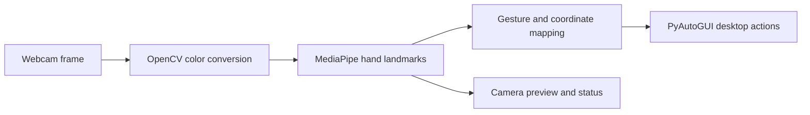

# Gesture Controlled Virtual Mouse


[](https://www.python.org/)
[](https://opencv.org/)
[](https://ai.google.dev/edge/mediapipe/solutions/vision/hand_landmarker)

Control the desktop pointer with a webcam and hand gestures. The local camera window shows the live image, detected hand landmarks, the tracking area, and whether desktop control is enabled. OpenCV captures and displays frames, MediaPipe detects hand landmarks, and PyAutoGUI sends pointer, click, and scroll actions to the operating system. A physical webcam and local desktop session are required; this project is not a browser app.

## What it does

| Gesture or control | Desktop action |
| --- | --- |
| Move the index fingertip inside the blue tracking box | Move the pointer, with smoothing |
| Pinch thumb and index finger | Click, with a short repeat delay |
| Raise index and middle fingers and move vertically | Scroll; a dead zone and cooldown reduce jitter |
| Press `t` in the camera window | Enable or pause desktop control |
| Press `q` in the camera window | Exit |

The preview starts with desktop control **off**. Hand tracking remains visible while control is paused.

## How the flow works



## Requirements

- Python 3.9 or newer and a desktop session with a webcam.
- macOS, Windows, or Linux with GUI access. On macOS, grant camera access and Accessibility permission to the terminal or IDE used to run the program.
- Dependencies listed in [`requirements.txt`](requirements.txt). The app uses MediaPipe Tasks (MediaPipe 0.10.31 or newer) and a small official hand-landmarker model downloaded separately.

## Quick start

```bash
git clone https://github.com/ayushcodes13/gesture-controlled-virtual-mouse.git
cd gesture-controlled-virtual-mouse
python3 -m venv .venv
source .venv/bin/activate       # Windows: .venv\Scripts\activate
python -m pip install -r requirements.txt
python scripts/download_hand_model.py
python main.py
```

The preview opens with desktop control disabled. Focus the preview window and press `t` to enable pointer movement and gestures. Keep the hand visible in the blue rectangle. Press `t` again to pause desktop control, or `q` to close the program. If the camera cannot be opened, check OS camera permission and that another app is not using it.

The model download script verifies the official model's SHA-256 before saving it under `models/`; the model file is intentionally excluded from Git.

## Preview and verification

The product UI is the local OpenCV camera window; there is no browser control panel. A real UI screenshot requires the application to run on a machine with the dependencies installed, an accessible webcam, and a graphical desktop. Screenshots are not included because those device-dependent conditions were unavailable in the documentation environment; the diagram below describes the implemented data flow, not a captured runtime.

The repository includes `check_installation.py` for checking imports, camera access, Python version, and screen dimensions:

```bash
python check_installation.py
```

Camera and desktop-control behavior require a physical camera, an interactive display, and OS permissions. Those device-dependent interactions are not represented as verified unless tested on a configured machine. Gesture quality can vary with lighting, camera placement, and hand position; this is a small desktop prototype, not an accessibility or medical device.

## Privacy and limits

Frames are processed locally by the application and are not uploaded by this code. The program has access to the webcam while running and can send desktop pointer actions after control is enabled. PyAutoGUI's fail-safe stays enabled; if it triggers during a mouse action, the application reports it and stops. Use the app only in a trusted local session. Sustained arm positioning can cause fatigue, and precise work may be difficult.

## Deployment

The core workflow is a native desktop application. Vercel cannot provide its local webcam, interactive OpenCV preview, or OS-level pointer control. The self-contained [`site/`](site/) directory is a static project presentation only; it has no camera access or interactive gesture demo. To publish that presentation on Vercel, import this repository, set the Root Directory to `site`, select the Other framework preset, and leave build and output commands empty. No deployment has been created from this repository yet.

## Project files

- [`main.py`](main.py): webcam loop, hand landmark processing, gesture recognition, preview window, and desktop actions.
- [`fixed_main.py`](fixed_main.py): alternate implementation retained in the repository; the documented entry point is `main.py`.
- [`check_installation.py`](check_installation.py): local environment and device check.
- [`report.md`](report.md): original academic-style project report. Some reported results and features are not verified by this repository's automated checks; treat them as historical project claims.

## License

No license file is currently included. Check with the project owner before reusing or distributing this code.

## Author

[Ayush Rout](https://github.com/ayushcodes13)
